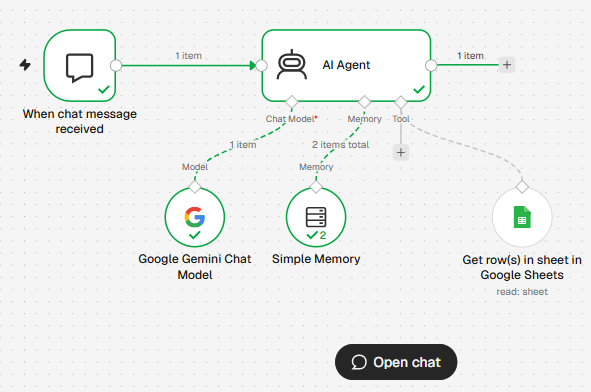

# n8n Customer Support Agent

An AI customer support agent built with n8n. It answers customer questions using a Google Sheets FAQ and replies in Roman Urdu. If the answer is not in the FAQ, it says it will confirm with the team instead of making things up.

## Demo

## Features
- Answers customer questions from a Google Sheets FAQ
- Remembers the conversation (Simple Memory)
- Does not invent answers when information is missing
- Replies in a polite, short style in Roman Urdu

## Tools Used
- n8n
- Google Gemini (AI model)
- Google Sheets

## Workflow
`Chat Trigger → AI Agent (Gemini + Simple Memory + Google Sheets tool)`

## How to Use
1. Import `customer-support-agent.json` into n8n (Workflow menu → Import from file)
2. Add your own Gemini API key as a credential
3. Create a Google Sheet with the columns `Question` and `Answer`, and connect it to the Google Sheets tool
4. Open the chat and ask a question, for example: "Delivery kitne din mein hoti hai?"

## Future Improvements
- Connect to WhatsApp or Telegram
- Alert a human when the agent cannot answer

## Author
Muhammad Farhan
